# ha-tv-guide-card

[](https://www.home-assistant.io/integrations/marketplace/)
[](https://github.com/juju35/ha-tv-guide-card/actions/workflows/hacs.yml)
[](https://github.com/juju35/ha-tv-guide-card/actions/workflows/validate.yml)
[](https://github.com/juju35/ha-tv-guide-card/actions/workflows/lint.yml)
[](https://github.com/juju35/ha-tv-guide-card/releases/latest)
[](https://github.com/juju35/ha-tv-guide-card/blob/main/LICENSE)
[](https://buymeacoffee.com/julienstep9)

<p align="center"></p>

<p align="center">
  <a href="https://github.com/shadow578/homeassistant_xmltv-epg"></a>&nbsp;&nbsp;
  <a href="https://github.com/cyclope205/programme-tnt-fr"></a>&nbsp;&nbsp;
  <a href="https://github.com/yohaybn/HomeAssistant-EPG"></a>&nbsp;&nbsp;
  <a href="https://github.com/janfajessen/What-s-On-TV---EPG-TV-Guide---Home-Assistant"></a>&nbsp;&nbsp;
  <a href="https://github.com/elyobelyob/freely_tv_guide_new"></a>&nbsp;&nbsp;
  <a href="https://github.com/mutzl/netdaemon-epg"></a>&nbsp;&nbsp;
  <a href="https://github.com/zupancicmarko/JellyHA"></a>&nbsp;&nbsp;
  <a href="https://www.home-assistant.io/integrations/calendar/"></a>
</p>

A Lovelace card for **tonight's TV**: the programme of each of your channels at prime time (or what is on now), with a progress bar while on air, genre filters, and a play button that tunes your TV, box or media player.

[](https://my.home-assistant.io/redirect/marketplace_repository/?owner=juju35&repository=ha-tv-guide-card&category=plugin)

| Card | Type | What it shows |
|---|---|---|
| [TV guide](#screenshots) | `custom:tv-guide-card` | Tonight's programme on each channel, genre filters, progress bars and play buttons. |
| [TV guide mini](#tv-guide-mini) | `custom:tv-guide-mini-card` | The programme to watch on two lines, with a zoom to the full card. |

| On air | Before the evening |
|---|---|
| 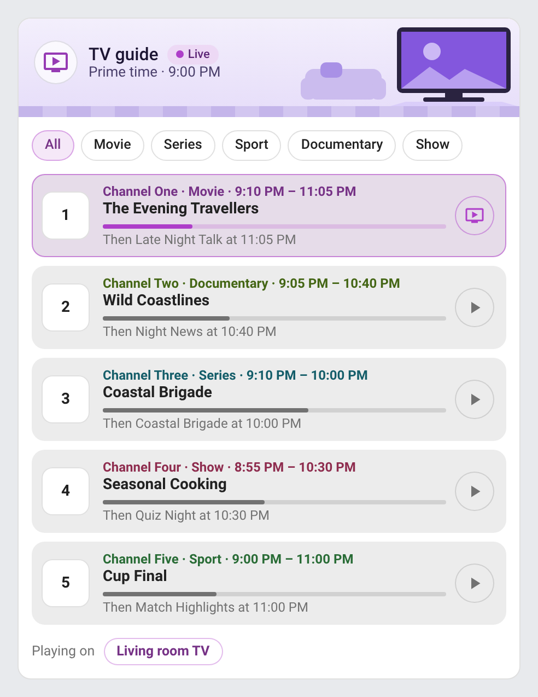 | 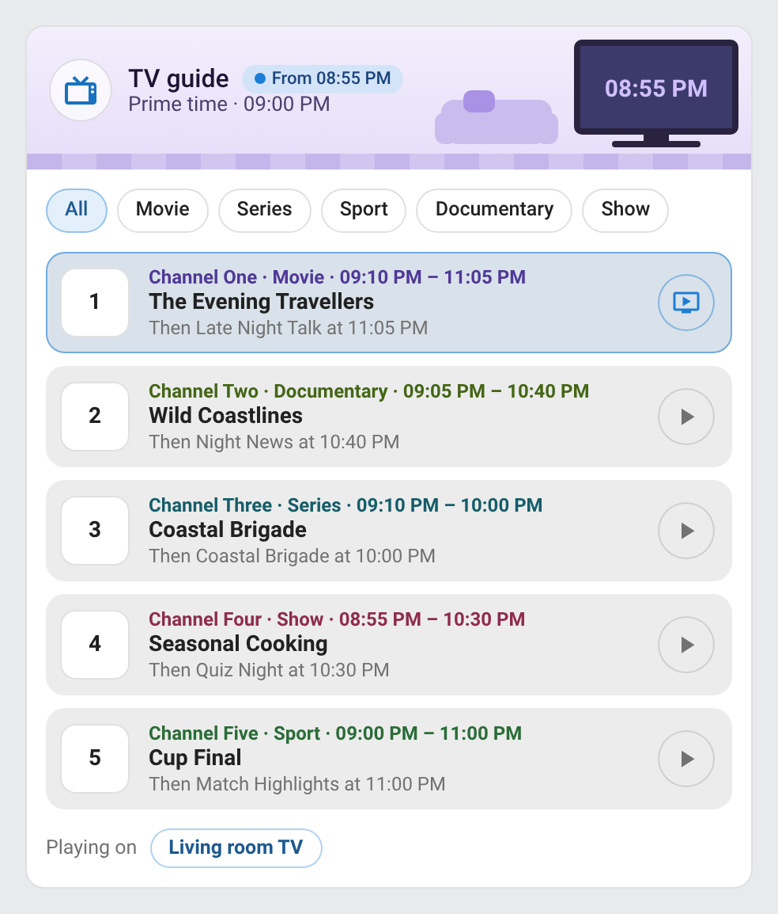 |

## Features

- **One row per channel**: its logo (from the EPG integration or the config) or its number, the genre and the times, the programme's title, a **progress bar** while it is on air and the programme that follows
- **Tonight or now**: the programme on at prime time (`prime_time`, 21:00 by default) — or, once the evening has begun, the one on air — or simply what is on now (`mode: now`)
- **Genre filters**: movie, series, sport, kids, news, documentary, show — from the guide's category, else found in the title and description in the card's 22 languages
- **Play button** (optional): plays the channel's stream on a media player, selects a source, or runs a script or any action — the channel being watched is highlighted
- **Several EPG sources**, even mixed in one card: XMLTV EPG, Programme TNT FR, EPG (open-epg.com), any calendar, and sensors written by hand
- **Illustrated header**: a living room whose television shows a changing picture while on air (its light falls on the floor), the time of the evening's first programme before it, a dark screen with nothing on; the dark theme darkens the room
- **Mini card**: two lines — the programme to watch with when it ends, then the channel and the times — and a small television; its zoom button opens the full card in place
- **Tap a row** to open its EPG entity's details, and the player's name to open the player
- Visual editor for both cards, light and dark themes, 22 languages, no external dependency

## Supported integrations

The card reads the programmes of these EPG integrations, through one adapter each; a channel may combine several entities (an XMLTV EPG *current* and *upcoming* sensor, say).

| | Integration | What the card reads |
|:---:|---|---|
|  | [XMLTV EPG](https://github.com/shadow578/homeassistant_xmltv-epg) (Marketplace) | Any XMLTV guide: one sensor per channel and mode (current, upcoming, prime time) — `title`, `start`, `end`, `description`, `category` |
|  | [Programme TNT FR](https://github.com/cyclope205/programme-tnt-fr) (Marketplace) | French TNT channels: `current`, `next`, `prime_time`, `second_part`, with `channel_name` and `channel_icon` |
|  | [EPG](https://github.com/yohaybn/HomeAssistant-EPG) (Marketplace, open-epg.com) | Most of the world: the `today` / `tomorrow` schedules, the programme on air and the next one, `channel_display_name` and `channel_icon` |
|  | [What's On TV](https://github.com/janfajessen/What-s-On-TV---EPG-TV-Guide---Home-Assistant) (Marketplace) | Any XMLTV guide, worldwide: one sensor per channel — its `schedule` (`title`, `start`, `end`, `description`, `image`), `next_title`, `channel_name`, `channel_icon` |
|  | [Freeview EPG Splitter](https://github.com/elyobelyob/freely_tv_guide_new) (RESTful sensors) | UK Freeview: the `event` list (`name`, `startTime`, `duration`, `description`) and the `channel` name of each REST sensor set up from its README |
|  | [netdaemon-epg](https://github.com/mutzl/netdaemon-epg) (NetDaemon app) | Germany and Austria (HÖRZU, ORF): `sensor.epg_<provider>_<station>` — the show on air with `BeginTime`, `Duration`, `Genre`, `Description`, and the `Upcoming` title |
|  | [Calendars](https://www.home-assistant.io/integrations/calendar/) (built in) | The events of any calendar — an XMLTV or ICS guide added with [Remote calendar](https://www.home-assistant.io/integrations/remote_calendar/), say |
|  | [Template](https://www.home-assistant.io/integrations/template/) / [RESTful](https://www.home-assistant.io/integrations/rest/) sensors (built in) | A list attribute (`programmes`, `programs`, `epg`, `schedule`, `events`, `event`) of `{ title, start, end or duration, genre }`, or the state as the programme on air with its `start` and `end` |

The play button works with any [media player](https://www.home-assistant.io/integrations/media_player/) (`play_media` or `select_source`), a script or an action — a TV's inputs, a box's remote, a stream URL — and is not needed to show the guide. With [JellyHA](https://github.com/zupancicmarko/JellyHA) , `jellyfin_channel` tunes a Jellyfin Live TV channel on a JellyHA player (`jellyha.play_live_tv_channel`); JellyHA has no programme guide of its own, so the programmes come from one of the sources above.

Not supported: [kan_program](https://github.com/eyalcha/kan_program) (Israel) still uses `device_state_attributes`, which Home Assistant no longer exposes, so its sensors carry no start or end time.

## Installation

### Via the Marketplace (recommended)

Click the button below to add the repository directly:

[](https://my.home-assistant.io/redirect/marketplace_repository/?owner=juju35&repository=ha-tv-guide-card&category=plugin)

Or manually:

1. Open **Settings → Marketplace → Add from link** (top right; this needs a GitHub account connected)
2. Add `https://github.com/juju35/ha-tv-guide-card` — Type: **Dashboard**
3. Open **TV Guide Card** and click **Install**
4. Clear your browser cache and refresh

The Marketplace registers the dashboard resource for you.

### Manual

1. Download `ha-tv-guide-card.js` and the `ha-tv-guide-card.i18n.*.js` translation files from the [latest release](https://github.com/juju35/ha-tv-guide-card/releases/latest)
2. Copy them all to `/config/www/` (without the translation files, the cards show in English)
3. Go to **Settings → Dashboards → Resources** → Add resource:
   - URL: `/local/ha-tv-guide-card.js`
   - Type: **JavaScript Module**
4. Clear your browser cache and refresh

## Configuration

Every option is in the visual editor; `channels`, a list, is written as YAML in its advanced section. In YAML:

```yaml
type: custom:tv-guide-card
player: media_player.living_room_tv
channels:
  # An XMLTV EPG channel: its current and upcoming sensors; the play button plays its stream
  - epg:
      - sensor.channel_one_current
      - sensor.channel_one_upcoming
    name: Channel One
    media_content_id: http://tv.example.local/live/1.ts
    media_content_type: video
  # A Programme TNT FR channel: its name and logo come from the integration; the play button runs a script
  - epg: sensor.programme_tnt_fr_channel_two
    script: script.zap_channel_two
  # An EPG (open-epg.com) channel, tuned by an input of the TV
  - epg: sensor.epg_channel_three
    source: HDMI 2
  # A calendar of programmes, tuned by a remote
  - epg: calendar.channel_four
    name: Channel Four
    action: remote.send_command
    data:
      entity_id: remote.tv_box
      command: "4"
  # A What's On TV channel, tuned on a Jellyfin Live TV player (JellyHA) by its number
  - epg: sensor.epg_channel_five
    player: media_player.jellyfin_living_room
    jellyfin_channel: 5

# What is on now, on two lines
type: custom:tv-guide-mini-card
mode: now
channels:
  - sensor.programme_tnt_fr_channel_two
```

| Option | Type | Default | Description |
|---|---|---|---|
| `title` | string | `TV guide` | Both: card title |
| `show_title` | boolean | `true` | Both: show the title |
| `show_subtitle` | boolean | `true` | Both: the prime time (or *On now*) under the title |
| `navigation_path` | string | | Both: a tap on the header opens this dashboard path |
| `channels` | list | the EPG sensors found, in the card picker | Both, as YAML (in the editor's advanced section too): an entity id, or `epg` (an entity or a list of entities: EPG sensors, calendars), `name`, `number`, `logo`, and what the play button does — `media_content_id` (+ `media_content_type`, default `channel`) or `source` on the player, `jellyfin_channel` (a JellyHA Live TV channel number or name, `true` for the channel's name) on a JellyHA player, `script`, or `action` (+ `data`); `player` overrides the card's player for that channel |
| `player` | entity | | Both: the media player the play buttons tune, and whose channel is highlighted |
| `mode` | string | `tonight` | Both: `tonight` (the programme on at prime time, or on air once the evening has begun) or `now` |
| `prime_time` | time | `21:00` | Both: when the evening's programmes begin |
| `max_items` | number | `6` | Both: the first channels of the list shown |
| `show_genres` | boolean | `true` | Full card: the genre filters (with two genres or more) |
| `illustration` | boolean | `true` | Both: the illustrated header (`false`: the classic header) |
| `illustration_theme` | string | `auto` | Both: `auto` (follows the Home Assistant theme: night with a dark theme, day with a light theme), `day` or `night` |
| `animations` | boolean | `true` | Both: the picture changing on the screen and its light |
| `zoom` | boolean | `true` | Mini card: the zoom button |
| `language` | string | Home Assistant's | Advanced: one of the [languages](#translations) |

## Screenshots

| On air | Before the evening | Nothing in the guide |
|---|---|---|
|  |  | 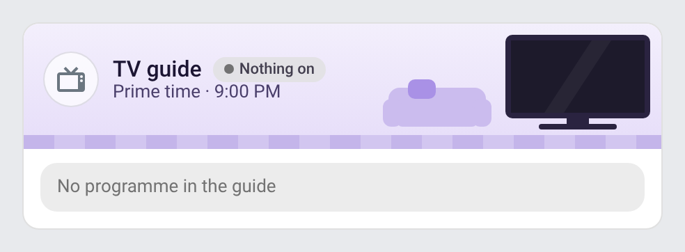 |
| 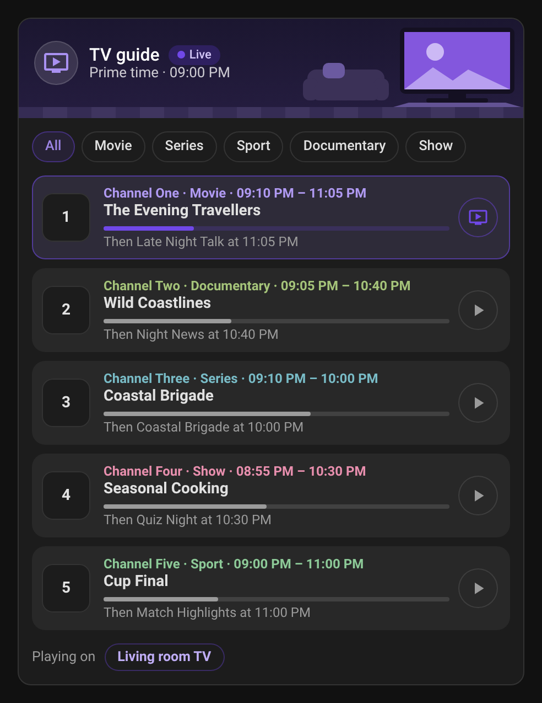 | 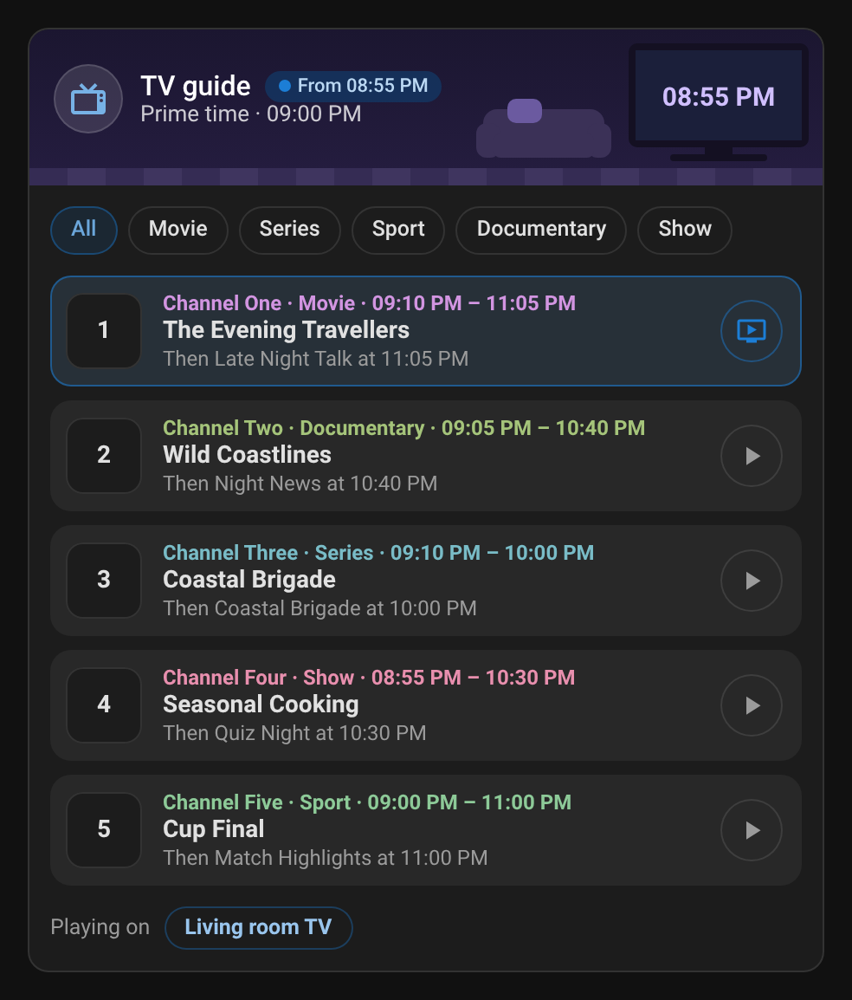 | 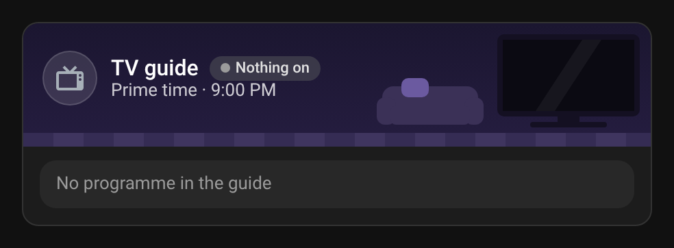 |

| Series only | Narrow |
|---|---|
| 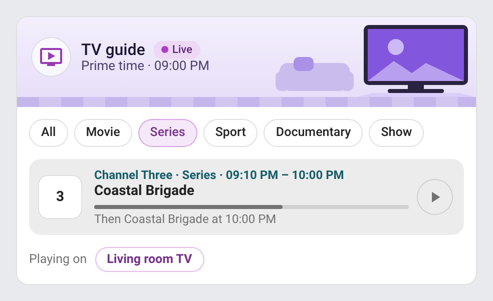 | 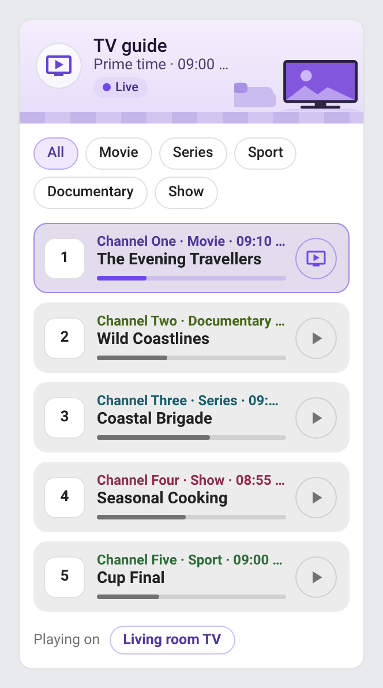 |
| 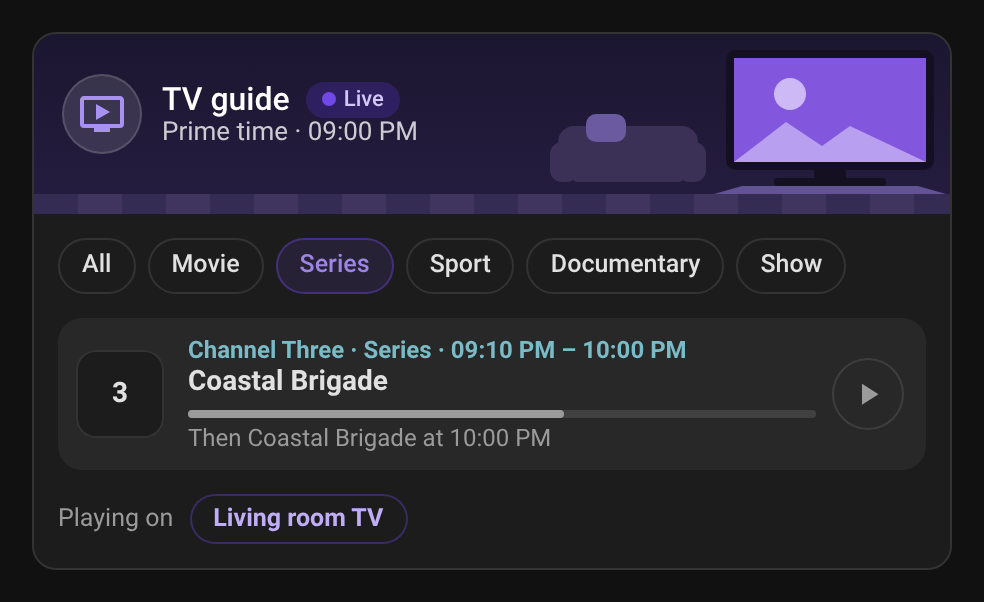 | 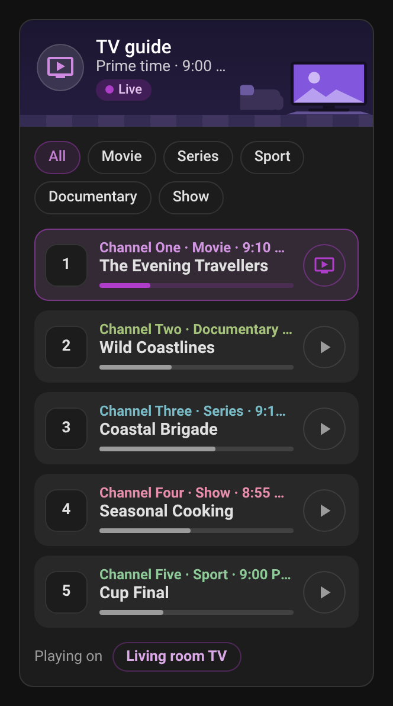 |

**Television animation**: while on air, a picture changes on the screen and its light breathes on the floor (still with `animations: false`, or when the system asks for reduced motion).

| Light | Dark |
|---|---|
|  |  |

### TV guide mini

| On air | Before the evening | Zoomed in |
|---|---|---|
| 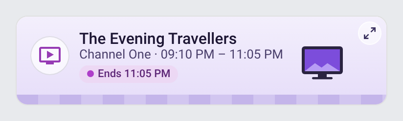 | 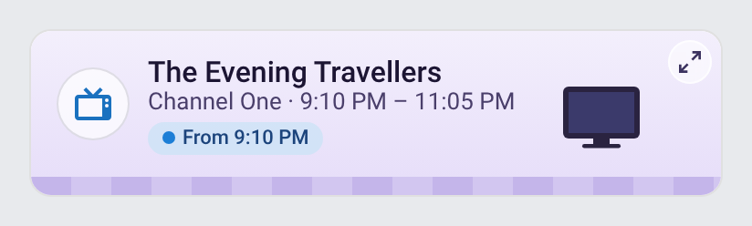 | 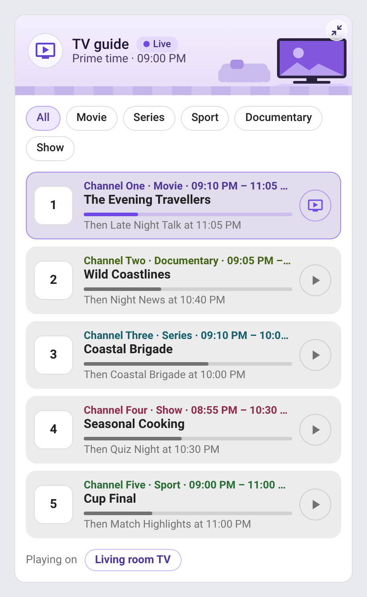 |
| 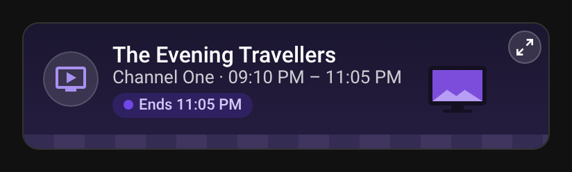 | 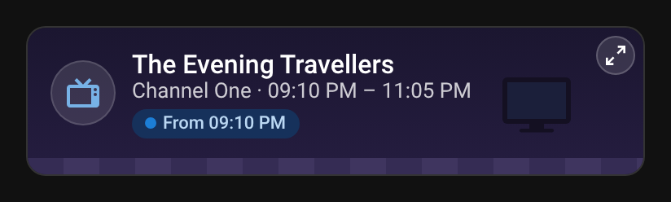 | 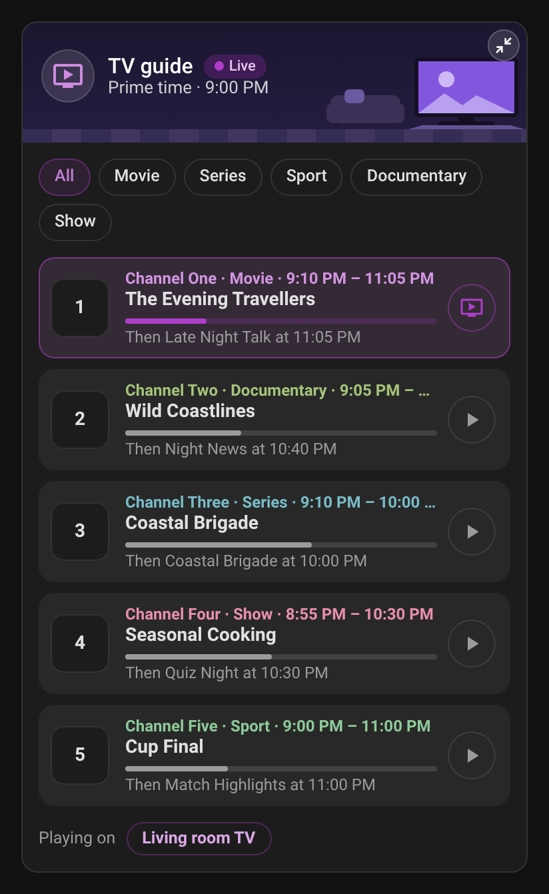 |

**Small television animation**: while on air, the mini card's screen changes colour.

| Light | Dark |
|---|---|
|  |  |

## How it works

- **Programme shown**: with `mode: tonight`, the one on at prime time today, or the one on air once the evening has begun; with `mode: now`, the one on air; failing that, the next one to start within 6 hours
- **XMLTV EPG**: the programme of each sensor of the channel (current, upcoming, prime time), merged
- **Programme TNT FR**: its `current`, `next`, `prime_time` and `second_part` programmes
- **EPG (open-epg.com)**: its `today` and `tomorrow` schedules (times in `HH:MM`, an end before the start being the next day), else the programme on air and the next one
- **Calendars**: their events from 12 hours ago to 24 hours ahead, through Home Assistant's calendar API, fetched again every 15 minutes
- **Other sensors**: a list attribute, else the state as the programme on air with its `start` and `end`; a programme without an end ends when the next one starts
- **Genre**: the guide's own category when it names one, else found in the category, the title and the description; *show* otherwise
- **Playing channel**: the player is playing (or paused) and its `media_content_id`, `media_channel`, `media_title` or `source` is the channel's
- **Refresh**: the card redraws on each change of its entities and every minute (progress bars)
- **Actions**: only the play buttons call one (`media_player.play_media`, `media_player.select_source`, `jellyha.play_live_tv_channel`, `script.turn_on` or the channel's `action`)

## Development

```bash
npm install
npm run build        # stamps the version of package.json into dist/ha-tv-guide-card.js
npm run check        # builds and checks the bundle (run in CI)
npm test             # unit tests
npm run screenshots  # renders the cards with mock channels into screenshots/ (and the GIFs, needs ffmpeg)
```

The source is split into ES modules under `src/shared/` (entry `src/shared/index.js`); `npm run build` assembles them (`scripts/bundle.mjs`) into the single file the Marketplace serves.

`dist/` is not committed: `npm run build` creates it locally, CI builds it on every push, and the release workflow attaches the built files to the release, which is where the Marketplace installs them from.

### Releasing

1. Bump `version` in `package.json`
2. Add a `## <version>` section at the top of [CHANGELOG.md](https://github.com/juju35/ha-tv-guide-card/blob/main/CHANGELOG.md)
3. Merge a `feat` or `fix` pull request into `main`: the **Release** workflow builds the card, creates the tag and the GitHub release with the changelog section as notes, and attaches `ha-tv-guide-card.js` and its translation files

## Translations

The card auto-detects the language from your Home Assistant settings. Currently supported:

| Language | Code |
|---|---|
| English | `en` |
| Français | `fr` |
| Deutsch | `de` |
| Español | `es` |
| Српски | `sr` |
| Srpski (latinica) | `sr-Latn` |
| Italiano | `it` |
| Nederlands | `nl` |
| Português (Portugal) | `pt` |
| Polski | `pl` |
| Română | `ro` |
| Dansk | `da` |
| Svenska | `sv` |
| Български | `bg` |
| Русский | `ru` |
| Українська | `uk` |
| Magyar | `hu` |
| Slovenčina | `sk` |
| Čeština | `cs` |
| Slovenščina | `sl` |
| Latviešu | `lv` |
| Ελληνικά | `el` |

Contributions for additional languages are welcome!

## License

[MIT](https://github.com/juju35/ha-tv-guide-card/blob/main/LICENSE)

## Support

If you find this project useful, you can support its development:

<a href="https://buymeacoffee.com/julienstep9"></a>
